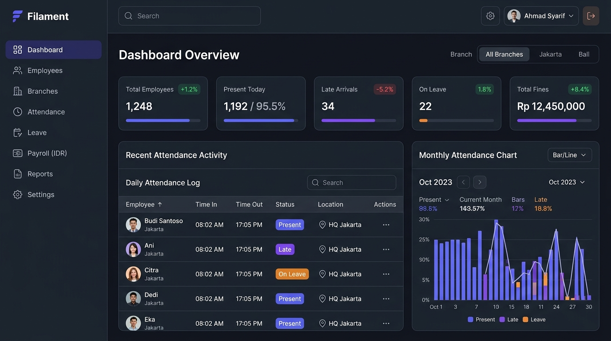
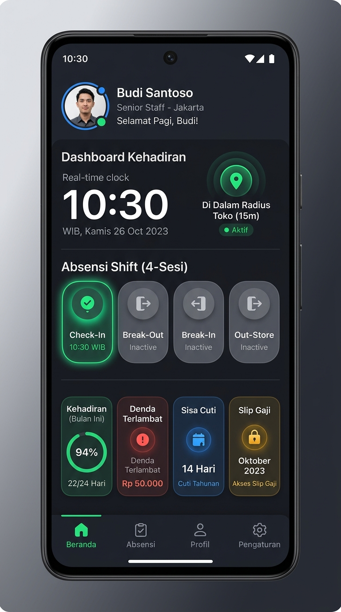
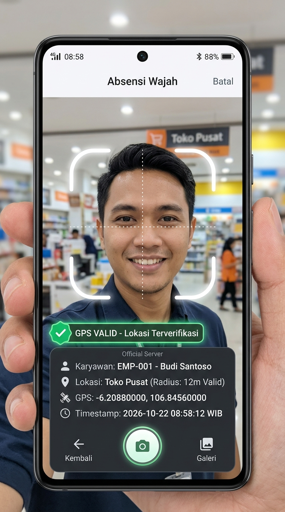

# 🏢 Sistem Absensi Multi-Cabang, Approval Berjenjang & Payroll

<p align="center">
  
</p>

<p align="center">
  
  
  
  
  
  
</p>

> [!NOTE]
> **📢 Repository Portofolio Publik (Showcase & Documentation Only)**  
> Repository ini difungsikan khusus sebagai etalase portofolio publik, dokumentasi fitur, dan showcase arsitektur sistem.  
> Seluruh source code mentah (*Laravel 11 Backend Core & Flutter Mobile Client*) disimpan pada repository private terpisah untuk melindungi hak kekayaan intelektual (*Proprietary Software*).  
> Untuk live demo, eksplorasi teknis, atau peluang kerja sama/implementasi, silakan hubungi pengembang melalui profil GitHub [@jetsix05](https://github.com/jetsix05).

Sistem presensi dan penggajian terintegrasi skala korporasi / retail multi-cabang. Dibangun dengan kombinasi **Laravel 11 & Filament v3** pada sisi backend dan **Flutter** pada aplikasi mobile Android. Dirancang khusus untuk membasmi segala bentuk kecurangan absensi (*anti-fraud*), otomatisasi kalkulasi denda dan potongan bertingkat, alur *approval* berjenjang (Headstore/SPV/HRD/Owner), serta distribusi slip gaji digital terenkripsi.

---

## 📱 Tampilan Antarmuka Aplikasi (Screenshots)

<table align="center" width="100%">
  <tr>
    <th width="50%" align="center"><b>Dashboard Mobile APK (Flutter)</b></th>
    <th width="50%" align="center"><b>Kamera Selfie Live & Watermark GPS</b></th>
  </tr>
  <tr>
    <td align="center">
      
      <br />
      <em>Dashboard terpadu presensi 4-sesi, status radius toko, denda & kuota izin.</em>
    </td>
    <td align="center">
      
      <br />
      <em>Kamera langsung (no gallery) dengan cap koordinat GPS & anti-fake GPS.</em>
    </td>
  </tr>
</table>

---

## 🌟 Fitur Unggulan (Key Features)

### 1. 🛡️ Mekanisme Anti-Curang & Anti-Titip Absen (Anti-Fraud Engine)
- **Anti-Fake GPS Hardware Detection:** Server menolak otomatis (*HTTP 403 `FAKE_GPS_DETECTED`*) jika mendeteksi penggunaan aplikasi Fake GPS / Mock Location pada Android.
- **Kamera Fisik Langsung:** APK hanya mengakses kamera depan secara langsung tanpa opsi memilih foto dari galeri.
- **Micro-Geofencing Haversine:** Perhitungan jarak GPS presisi tinggi hingga 8 digit desimal dengan toleransi radius meter cabang toko.
- **Selective Device Binding:** Penguncian akun pada satu `Device ID` fisik untuk mencegah akun dipindah-tangankan antar rekan kerja.
- **Burn-In Watermark & Kompresi Foto:** Foto selfie otomatis dikompresi (< 150KB) dan dicap watermark berisikan identitas karyawan, cabang, koordinat GPS, dan timestamp server.

### 2. ⏱️ Jam Kerja 4 Sesi (Split-Shift) & Fitur Approval Tidak Break
- **4 Sesi Presensi Harian:** Check-In (Sesi 1), Break-Out (Sesi 2), Break-In (Sesi 3), dan Out-Store (Sesi 4).
- **Approval Bebas Denda Istirahat (No-Break):** Karyawan yang bertugas penuh saat toko ramai dapat mengajukan permohonan No-Break ke Headstore via APK. Jika disetujui, karyawan dibebaskan dari denda lupa absen istirahat tanpa mengorbankan kepatuhan jam kerja.

### 3. ⚖️ Kalkulasi Denda Otomatis & Potongan Berjenjang Dinamis
- **Denda Nominal Rupiah:**
  - *Denda Keterlambatan:* Jam pertama Rp 2.000, jam berikutnya Rp 200/jam (dapat disesuaikan di panel admin).
  - *Denda Lupa Absen:* Denda independen untuk setiap sesi yang terlewat.
- **Master Potongan Berjenjang Tanpa Batas Level (`penalty_percentage_rules`):**
  - Mengatur potongan persentase insentif, potongan gaji pokok, dan pembatalan uang kerajinan untuk 4 kategori: `LEAVE`, `OPNAME`, `LATE`, dan `ALPHA`.
  - Mengambil level tertinggi yang dicapai dalam bulan berjalan dan dievaluasi simultan dengan denda rupiah.

### 4. 🏖️ Aturan Izin Cuti & Ganti Hari Mandiri (Weekend Replacement)
- **Kuota Izin:** Dibatasi maksimal 3x per bulan kalender.
- **Aturan Weekend / Hari Libur Toko = Ganti 2x di Weekday:**
  - Izin yang jatuh pada hari libur/weekend mewajibkan karyawan **memilih mandiri 2 hari pengganti di weekday** dari jadwal libur (OFF) mingguan mereka.
- **Kasus Izin Hari H / Pulang Cepat:**
  - Uang makan harian otomatis Rp 0.
  - Memotong kuota izin dan membebaskan denda sisa sesi hari tersebut.
  - Jika surat dokter menyusul (`is_medical_letter_pending`), tombol Check-In hari kerja berikutnya diblokir hingga surat diunggah.

### 5. 🔄 Penyesuaian Jadwal Mandiri & Tugas Luar (`schedule_change_requests`)
- Karyawan dapat mengajukan 3 tipe permohonan mandiri via APK:
  1. `EXCHANGE_OFF_DAY`: Tukar hari libur reguler ke hari kerja lain.
  2. `CHANGE_SHIFT`: Permohonan jam kerja khusus atau ganti shift.
  3. `OUTSIDE_DUTY`: Izin presensi di luar radius geofencing toko untuk tugas dinas.
- Persetujuan Headstore otomatis memperbarui jadwal kerja di `employee_schedules`.

### 6. 💬 Notifikasi WhatsApp Dua Arah (WAHA Docker Gateway)
- Notifikasi instan ke WhatsApp Atasan saat ada pengajuan izin, tukar jadwal, atau Tidak Break.
- Notifikasi konfirmasi balik ke WhatsApp Karyawan begitu permohonan disetujui (*Approved*) atau ditolak (*Rejected*) beserta catatannya.
- Pengiriman kredensial akun otomatis (Kode Karyawan & Password) saat staf baru didaftarkan.

### 7. 🔒 Pengamanan Digital Slip Gaji (Window Time & Anti-Screenshot)
- **Window Time Akses (Tanggal 1 s/d 7):** Menu dan API Slip Gaji hanya aktif pada tanggal 1 s/d 7 setiap bulannya. Di luar jendela waktu tersebut, tombol disembunyikan dan API mengembalikan status `403 SLIP_WINDOW_EXPIRED`.
- **Proteksi `FLAG_SECURE`:** Halaman slip gaji di aplikasi Android dilindungi teknologi anti-screenshot dan perekaman layar (*black screen*).
- **Penalti Alpha 1x:** 1 kali saja Alpha/mangkir dalam 1 bulan kalender mengakibatkan **Uang Insentif dan Uang Kerajinan otomatis HANGUS (Rp 0)**.

### 8. 🧹 Auto-Purge Penyimpanan Server
- Console scheduler harian otomatis membersihkan file fisik foto selfie absensi yang berusia > 60 hari untuk menghemat storage server aaPanel, sementara log teks data presensi tersimpan permanen.

---

## 🏗️ Arsitektur Teknologi & Modul

```
sistem-absensi-payroll/
├── app/
│   ├── Filament/Resources/       # Panel Admin (Employee, Attendance, Leave, Payroll, Rules)
│   ├── Http/Controllers/Api/     # RESTful API Endpoints (Sanctum)
│   ├── Models/                   # 18 Eloquent Models & Business Entities
│   └── Services/                 # Business Logic Services:
│       ├── AttendanceService.php     # 4-Session clocking & penalty evaluation
│       ├── GeofenceService.php       # GPS Haversine calculation & anti-mock
│       ├── ImageWatermarkService.php # Watermark burn-in & compression
│       ├── LeaveService.php          # Quota, weekend replacement & approvals
│       ├── PayrollService.php        # Salary recap, alpha penalty & tier cuts
│       ├── ScheduleChangeService.php # Self schedule changes & approvals
│       └── WahaService.php           # WhatsApp HTTP API gateway
├── database/migrations/          # 20 Database Migrations
├── docs/                         # Master Documentation:
│   ├── API_SPEC.md                   # 22 REST API Mobile Documentation
│   ├── BUSINESS_RULES.md             # Blueprint Logic & Workflow Bisnis
│   ├── DATABASE_SCHEMA.md            # Single Source of Truth Skema Database
│   └── PROGRESS_CHANGELOG.md         # Catatan Riwayat Rilis & Update
├── mobile_apk/                   # Mobile Client (Flutter Android):
│   ├── lib/screens/                  # Dashboard, Camera, Leave, Payroll, Approvals
│   ├── lib/services/                 # ApiService, LocationService, AuthService
│   └── AndroidManifest.xml           # Camera, GPS, & Internet Permissions
└── scripts/
    └── tunnel.sh                     # Cloudflare Tunnel Manager for Remote Access
```

---

## 🚀 Panduan Instalasi & Menjalankan

### 1. Kebutuhan Sistem (Server Prerequisites)
- **PHP:** $\ge 8.2$ / 8.3 (dengan ekstensi `pdo_mysql`, `gd`, `intl`, `mbstring`, `curl`)
- **Composer:** $\ge 2.2$
- **Database:** MariaDB 10.11 / MySQL 8.0
- **Node.js:** $\ge 18.x$ & NPM
- **WhatsApp Gateway:** Docker container [WAHA (WhatsApp HTTP API)](https://waha.devlike.pro/)
- **Mobile SDK:** Flutter $\ge 3.0.0$

### 2. Setup Backend Laravel 11
```bash
# Repository kode sumber bersifat private (dapat diakses dengan otorisasi pengembang)
# git clone https://github.com/jetsix05/sistem-absensi-payroll.git
cd sistem-absensi-payroll

# Install PHP dependencies
composer install

# Setup environment file
cp .env.example .env
php artisan key:generate

# Konfigurasi koneksi database di .env, kemudian jalankan migrasi & seeder
php artisan migrate --seed

# Hubungkan symbolic link penyimpanan foto
php artisan storage:link

# Jalankan server lokal (atau via Nginx aaPanel)
php artisan serve
```

### 3. Setup WhatsApp Gateway (WAHA Docker)
```bash
docker run -d --name waha -p 3000:3000 --restart always devlikeapro/waha
```
Sesuaikan konfigurasi `.env`:
```env
WAHA_BASE_URL=http://localhost:3000
WAHA_SESSION=notif_1
```

### 4. Setup Aplikasi Mobile (Flutter APK)
```bash
cd mobile_apk

# Install dependensi
flutter pub get

# Konfigurasi URL backend di lib/config/api_constants.dart
# static const String baseUrl = 'http://IP_SERVER_ANDA/api';

# Build file APK Release siap instal
flutter build apk --release
```
File APK siap pasang berada di: `mobile_apk/build/app/outputs/flutter-apk/app-release.apk`.

---

## 📖 Dokumentasi Lengkap
Untuk panduan mendalam dan spesifikasi teknis, silakan merujuk ke folder [`docs/`](./docs):
- [📄 Master Blueprint Alur Bisnis (BUSINESS_RULES.md)](./docs/BUSINESS_RULES.md)
- [📄 Skema Database & Relasi (DATABASE_SCHEMA.md)](./docs/DATABASE_SCHEMA.md)
- [📄 Spesifikasi REST API Mobile (API_SPEC.md)](./docs/API_SPEC.md)
- [📄 Catatan Perubahan & Progres (PROGRESS_CHANGELOG.md)](./docs/PROGRESS_CHANGELOG.md)

---

## 🔒 Lisensi & Hak Cipta
Hak Cipta © 2026. Seluruh hak cipta dilindungi undang-undang (*All Rights Reserved*).
Aplikasi ini dikembangkan secara tertutup untuk kebutuhan operasional enterprise multi-cabang.
